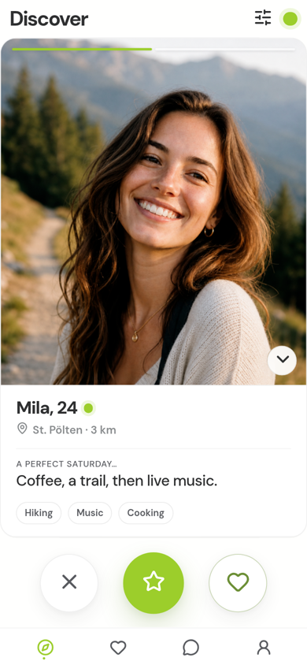
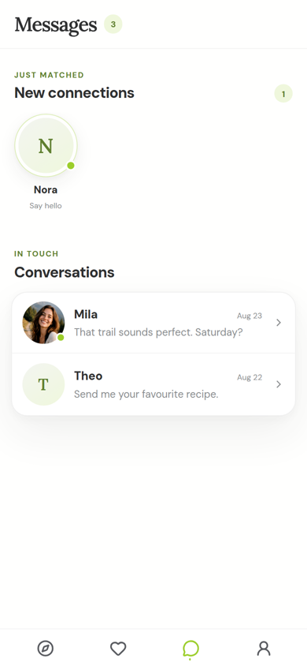
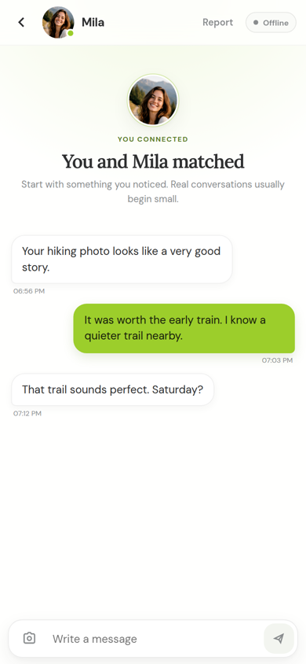
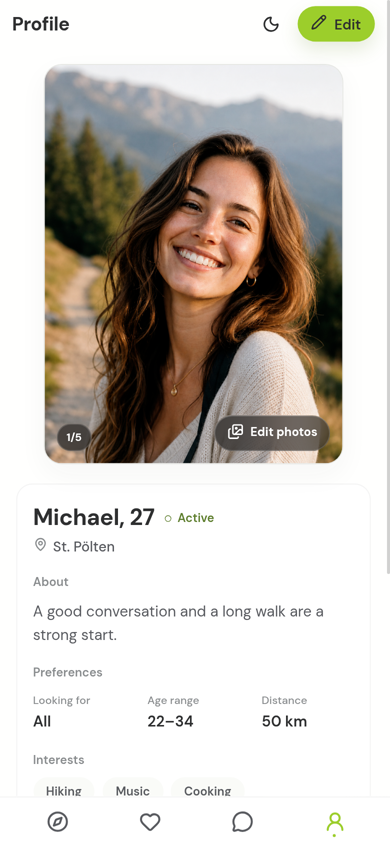

# Lunari — Matching Platform

A dating app built as microservices: CQRS deck reads, transactional outbox on Kafka, mTLS between services, and role-aware rate limits at the gateway.

**Live:** https://lunari.misyk.tech · [UI walkthrough (GIF)](docs/demo/preview-walkthrough.gif)

[](https://github.com/Misyk8925/tinder-clone/actions/workflows/policy.yml)
[](https://github.com/Misyk8925/tinder-clone/actions/workflows/security.yml)

<p align="center">
  
  
  
  
</p>

**Stack:** Java 21, Spring Boot, Quarkus, Go, FastAPI, Kafka, Redis, PostgreSQL/PostGIS, Keycloak, Angular (PWA).

## Architecture


- **Gateway** — single entry point; JWT auth (Keycloak) and per-role rate limits.
- **Deck / Deck Read** — Deck builds ranked decks asynchronously; Deck Read (Quarkus) serves them from Redis and calls `ensure` on a miss. Reverse indexes invalidate only affected decks on profile changes.
- **Swipes / Consumer** — swipes (Go) are stored with an outbox; Consumer detects mutual likes and emits `match.created`.
- **Match** — conversations and WebSocket chat.
- **Profiles, Location, Photos** — profile data, PostGIS location (Go), image storage and variants (FastAPI, S3).
- **Subscriptions** — Stripe payments → premium role via gRPC to Profiles.
- **Moderation** — content classification over Kafka (work in progress).

Sensitive internal calls (profile fan-out, swipe history, gRPC) go over mTLS.

## Quick start

Requires Docker and a JDK (for generating local certs).

```bash
./scripts/demo-up.sh
```

Open http://localhost:4200, register two users, create profiles, then swipe → match → chat. Keycloak runs at http://localhost:9080 (realm `spring`). The demo needs no Stripe or S3; photos are kept in memory.

For a production-like stack, copy `.env.prod.example` to `.env`, fill in the secrets, and run:

```bash
docker compose -f docker-compose.yml -f docker-compose.local.yml up -d --build
```

## Tests

```bash
cd services/<java-service> && mvn test
cd services/swipes-go && go test ./...
cd services/photos && pip install -r requirements-dev.txt && python -m pytest
```

Integration tests use Testcontainers (PostgreSQL, Redis, Kafka).

## Layout

```
services/   gateway, profiles, location-go, photos, deck, deck-read,
            swipes-go, consumer, match, subscriptions, moderation, tinder-contracts
clients/    tinder-client (Angular)
docs/       architecture notes, OpenAPI, demo materials
```
