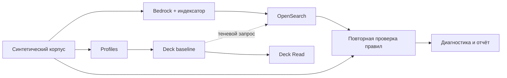

# Концепт: теневой взаимный семантический поиск для Deck

Статус: концепт одобрен запросом владельца реализовать представленный план, 2026-09-16.

## 1. Проблема и результат

Текущий Deck получает ограниченный пул кандидатов из Profiles, затем фильтрует свайпы и ранжирует пул. Он не измеряет, может ли семантический поиск по bio и hobbies найти допустимые профили за пределами этого пула. Эксперимент нужен владельцу продукта и разработчику ранжирования. Успех первого этапа — воспроизводимый отчёт на синтетических профилях о новых допустимых кандидатах, потерях Top-K, задержке, стоимости и нуле нарушений проверенных правил. Результат не доказывает рост реальных матчей.

## 2. Подтверждённые границы и решения

- Факт: `services/deck` строит и ранжирует колоду; Deck Read выдаёт готовую колоду. Теневая ветка принадлежит Deck и не записывает его пользовательский Redis snapshot.
- Факт: `SharedProfileDto` содержит bio и hobbies, но не gender самого профиля; `MatchingPreferences` содержит возраст, gender и радиус, без текста «кого ищу».
- Одобрено владельцем: использовать существующие hobbies как гипотезу о желаемых общих интересах; сравнивать только на синтетическом стенде; лимит расходов AWS — $100.
- Предложенное техническое решение: два текста и два вектора на профиль, по 512 измерений; веса направлений 0.6/0.4 зафиксированы до прогона. Эти параметры измеряются, а не объявляются оптимальными.
- Операционные блокировки реального прогона: доступность модели и NextGen vector collection в регионе, квоты Bedrock RPM и OpenSearch OCU, платёжные кредиты и фактический контроль затрат проверяются перед созданием ресурсов. AWS Budget оповещает с задержкой, поэтому он не является жёстким выключателем.
- Текущее ограничение владельца: **не вызывать AWS**. Облачный прогон и проверка аккаунта остаются отдельным будущим действием; локальная подготовка их не подразумевает.

## 3. Поведение простым текстом

Стенд создаёт 100 000 детерминированных профилей с bio, hobbies, возрастом, gender, координатами, видимостью, статусом модерации, блокировками и известной синтетической релевантностью. Он записывает профили в существующий путь Profiles и поддерживает отдельный исходный корпус для повторной индексации. Для кандидатов с hobbies создаётся `preferenceVector` из их списка интересов, трактуемого как интерес к общим занятиям; `identityVector` описывает bio и hobbies.

Когда Deck строит обычную колоду для синтетического зрителя, он независимо запускает тень. Два векторных запроса собирают кандидатов в обоих направлениях. Перед сравнением и выдачей отчёта тень повторно проверяет все доступные правила допуска по полному синтетическому корпусу, исключает просмотренных, удалённых и недопустимых кандидатов и применяет текущий ranker. Она не меняет Redis snapshot, событие построения деки и ответ Deck Read. Если данные неполны или AWS недоступен, тень регистрирует fallback и прекращает свой расчёт без влияния на baseline.

Отчёт различает позиции на одном и том же пуле и кандидатов, которых baseline вообще не видел. Объяснение берётся только из подтверждённого пересечения hobbies. Старые likes, если есть, показываются отдельно как смещённая к ранее показанным профилям метрика.

## 4. Функциональные требования

| ID | Требование |
|---|---|
| FR-1 | Генератор с фиксированным seed создаёт 100 000 синтетических профилей и проверяемую релевантность. |
| FR-2 | Индексатор создаёт два 512-мерных вектора и фильтруемые поля, обновляет/удаляет документ по изменению профиля и повторяет индексацию из исходного корпуса. |
| FR-3 | Deck запускает теневой расчёт при построении baseline и никогда не записывает теневой порядок в пользовательскую колоду. |
| FR-4 | Тень ищет оба направления, объединяет пулы и вычисляет forward, reverse и фиксированный взвешенный score. |
| FR-5 | Тень проверяет жёсткие правила после получения документов из индекса по полной синтетической записи и исключает устаревшие документы. |
| FR-6 | Тень применяет текущий ranker к допустимому пулу и формирует сравнение с baseline, отмечая отсутствующую baseline position. |
| FR-7 | Тень формирует объяснение только из общих подтверждённых hobbies; без них объяснения нет. |
| FR-8 | Стенд сохраняет диагностику и сводный отчёт, останавливает задания по лимитам объёма/времени и удаляет временные ресурсы после прогона. |

## 5. Измеримые ограничения

| ID | Критерий |
|---|---|
| NFR-1 | 0 нарушений проверенных жёстких правил в теневом Top-20 на полном синтетическом корпусе. |
| NFR-2 | 100 000 профилей, seed и версии модели/текстового формата записаны в отчёт; повтор seed даёт тот же корпус и синтетическую истину. |
| NFR-3 | Тень имеет timeout 2 секунды на тёплый поиск и не удерживает публикацию baseline; p50/p95 тёплого поиска и холодный старт измеряются отдельно. |
| NFR-4 | Пользовательские HTTP и Deck Read ответы, Redis snapshots и события не меняются при успехе или ошибке тени. |
| NFR-5 | Только синтетические bio попадают в Bedrock/OpenSearch; диагностика не сохраняет исходные bio или секреты. |
| NFR-6 | Плановый максимум расходов $100, ограничение количества и времени задач, AWS Budget alarm и удаление коллекции после прогона; фактические расходы указываются в отчёте. |
| NFR-7 | Отчёт содержит overlap Top-20, новые допустимые кандидаты, потери Top-K относительно широкого пула, fallback rate и выборки задержек. |

## 6. Решение, альтернатива и риски

Дешёвая альтернатива — ранжировать общие hobbies без векторного индекса. Она остаётся обязательным контрольным вариантом: если векторная ветка не находит дополнительную синтетическую релевантность при сопоставимой стоимости, индекс не оправдан. Векторный индекс нужен именно для проверки FR-4 и NFR-7, а не как постоянная инфраструктура по умолчанию.

Риски: два направления по одному набору hobbies могут быть сильно коррелированы; синтетическая истина может незаметно повторять алгоритм; индекс может отставать; текущий реальный DTO и сервисы не несут все поля для полноценной производственной проверки blocked/reported/moderation/gender. Отчёт обязан разделять правила, реально проверенные в стенде, и правила, ещё не интегрированные с продуктом. Выпуск на реальных пользователей — отдельное решение.
