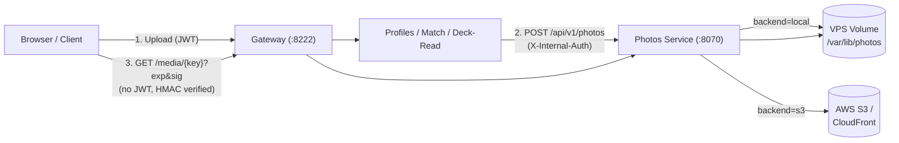

# Concept: Local VPS Media Storage & Storage Abstraction

## Problem

Today, `services/photos` can only persist images to AWS S3 (`S3Storage`) or keep them in RAM (`MemoryStorage`). Running the app on a single VPS without AWS requires either paying for S3/CloudFront or losing every uploaded photo on container restart (and `MemoryStorage` cannot serve image bytes over HTTP). In addition, `docker-compose.yml` fails to boot without `AWS_ACCESS_KEY_ID`, `AWS_SECRET_ACCESS_KEY`, `AWS_S3_BUCKET`, and `CLOUDFRONT_DOMAIN`, and storage backend selection is hardcoded to an implicit `if aws_s3_bucket` branch in `app/main.py`.

## Contracts and behaviour in plain text

- **Backend selection:** An operator selects the storage backend via `PHOTOS_STORAGE_BACKEND` (`local`, `s3`, or `memory`). If unset, the service preserves backward compatibility (`s3` when `AWS_S3_BUCKET` is non-empty, otherwise `memory`). Unknown backend names fail startup fast with a clear configuration error.
- **Unified storage abstraction:** `PhotoService` talks only to a single `MediaStorage` abstraction (`put`, `get`, `delete`, `list_keys`, `public_url`, `presigned_download_url`). Both AWS S3 and Local VPS storage implement this contract and are built through one factory/registry.
- **Local VPS persistence:** When `local` is active, uploading a photo writes all four JPEG variants (`original`, `large`, `medium`, `small`) atomically to disk under `PHOTOS_LOCAL_ROOT` (default `/var/lib/photos`, backed by a Docker named volume `photos-data`). Deleting a photo removes all four files (and empty parent directories). Orphan cleanup lists keys on disk under the owner prefix and deletes uncatalogued storage IDs.
- **Signed local downloads:** For `local`, `presigned_download_url` mints a URL pointing to `PHOTOS_PUBLIC_BASE_URL` + `/media/{key}?exp={unix_ts}&sig={hmac_sha256}` using a dedicated signing secret (`PHOTOS_SIGNING_SECRET`, falling back to `PHOTOS_INTERNAL_AUTH_SECRET` if unset). `GET /media/{key}` verifies the signature in constant time, rejects expired/tampered/missing signatures with `403`, rejects unknown/missing files with `404`, and streams the JPEG with `Content-Type: image/jpeg` and `Cache-Control: private, max-age=<remaining>`.
- **Gateway routing & Deck-Read compatibility:** `gateway` forwards `GET /media/**` to `photos:8070` without requiring a JWT (the HMAC signature authorizes the fetch, matching S3 presigned URLs for browser `` tags). `deck-read` `PhotoObjectRef.parse` accepts URLs with a leading `/media/` segment so deck cards continue re-signing URLs seamlessly.
- **What the system refuses to do:** It never serves files outside `PHOTOS_LOCAL_ROOT` (path traversal is rejected), never serves unsigned or expired `/media/` requests, and never weakens `X-Internal-Auth` on `/api/v1/photos/**`.

## Functional requirements

- **FR-1:** `services/photos` supports a pluggable media storage abstraction with explicit backend selection via `PHOTOS_STORAGE_BACKEND` (`local`, `s3`, `memory`) and backward-compatible default when unset.
- **FR-2:** The `local` storage backend stores uploaded photo variants (`original`, `large`, `medium`, `small`) atomically on the local filesystem under `PHOTOS_LOCAL_ROOT`.
- **FR-3:** The `local` storage backend deletes all four variant files for a given `(namespace, owner_id, storage_id)` and supports `list_keys(prefix)` so orphan cleanup removes only uncatalogued photos.
- **FR-4:** The `local` storage backend generates HMAC-SHA256 expiring download URLs under `{PHOTOS_PUBLIC_BASE_URL}/media/{key}?exp=...&sig=...`.
- **FR-5:** `services/photos` exposes `GET /media/{key:path}` that validates signature, expiry, and path containment, and returns the stored JPEG bytes (`200`), `403` for invalid/expired signatures, or `404` for missing objects.
- **FR-6:** `services/gateway` routes `GET /media/**` to `photos` without requiring a JWT so browsers can load signed local media URLs directly.
- **FR-7:** `services/deck-read` `PhotoObjectRef.parse` recognizes both `/photos/...` and `/media/photos/...` URL paths so deck card URL rewriting works identically for S3/CloudFront and local storage.
- **FR-8:** `docker-compose.yml` and `.env.prod.example` support running with `PHOTOS_STORAGE_BACKEND=local` using a persistent Docker named volume (`photos-data:/var/lib/photos`) without requiring real AWS credentials.
- **FR-9:** Automated end-to-end tests verify the full local storage lifecycle (HTTP upload → real files on disk → HTTP GET via signed URL → delete removes disk files → orphan cleanup).

## Non-functional requirements

- **NFR-1 (Security — path traversal):** 100% of path traversal attempts (`..`, absolute paths, encoded slashes, symlinks escaping root) are rejected with `400`/`403`/`404` and never touch files outside `PHOTOS_LOCAL_ROOT`.
- **NFR-2 (Security — signed URLs):** Local download signatures use HMAC-SHA256 verified with constant-time comparison; URLs expire after `PHOTOS_PRESIGN_EXP_SECONDS` (default 300 s).
- **NFR-3 (Durability — atomic writes):** Local writes use temp-file + `os.replace` so readers never observe half-written JPEG files.
- **NFR-4 (Latency):** Local variant write/read overhead adds < 20 ms p95 for a 500 KB JPEG on local SSD (in-process test baseline).
- **NFR-5 (Compatibility):** Existing `s3` and `memory` behaviour and all existing `/api/v1/photos/**` request/response JSON shapes remain 100% backward-compatible.

## Out of scope

- Migrating existing photos from S3 to local disk (or vice versa).
- Multi-node shared filesystem replication (NFS/Gluster/MinIO) or automated VPS disk backups.
- Changing image dimensions, JPEG quality, or upload size limits.
- Public unauthenticated static serving of user or chat photos.
- Production VPS deployment (validation and local smoke checks only).

## Suggested solution (cheapest baseline)

Keep all media storage inside `services/photos` and introduce a clean `app/storage/` package:
- `base.py`: `MediaStorage` protocol/ABC (`put`, `get`, `delete`, `list_keys`, `public_url`, `presigned_download_url`) + `ObjectNotFoundError`.
- `signing.py`: small pure-Python HMAC-SHA256 URL signer/verifier (`exp` + `sig`).
- `local.py`: `LocalFilesystemStorage` (atomic `write` via temp file + `os.replace`, strict `Path.resolve().is_relative_to(root)` guard, `get`, `delete`, `list_keys`, signed URL minting).
- `s3.py`: existing `S3Storage` moved cleanly under the same package and contract.
- `memory.py`: existing `MemoryStorage` moved under the same package (also implementing `get` for test parity).
- `factory.py`: `build_storage(settings)` registry mapping `local` / `s3` / `memory` (with backward-compatible fallback when `PHOTOS_STORAGE_BACKEND` is empty).

### Rejected alternatives

1. **MinIO / self-hosted S3 container on the VPS:** Rejected — adds ~256–512 MB RAM, another container to monitor/upgrade, and extra Compose complexity when FR-2..FR-5 are satisfied with zero extra processes using local disk + HMAC URLs.
2. **Nginx sidecar / external reverse proxy serving raw static files:** Rejected — fails NFR-2 (cannot enforce expiring per-object HMAC signatures without `ngx_http_secure_link_module` custom builds and keeps routing rules outside the app repo).
3. **Proxying media bytes through `profiles` / `match` with JWT auth:** Rejected — breaks browser `` loading (browsers do not attach `Authorization: Bearer` headers to image tags) and adds unnecessary JVM memory pressure on every image fetch.
